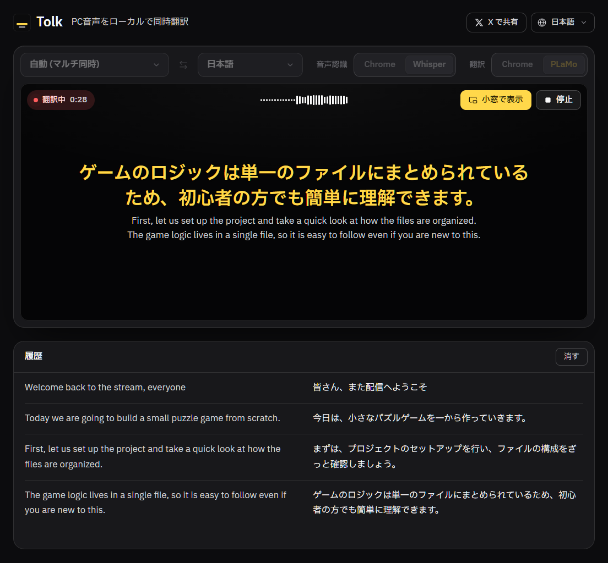

# Tolk

[日本語](#日本語) | [English](#english)



## 日本語

PCの音をブラウザだけで同時翻訳する Web アプリ

共有した画面やタブの音声を聞き取り、訳した字幕を表示します。\
音声認識と翻訳はすべてブラウザの中で動き、音声も文字も外部には送りません。

デモ：<https://noxelwork.com/tolk>

### 使い方

1. デスクトップ版の Chrome で開きます。
2. 話されている言語と字幕の言語、音声認識と翻訳の方式を選びます。
3. 「画面を選んで翻訳を始める」を押し、共有ダイアログで画面かタブを選んで「音声も共有する」をオンにします。
4. 訳した字幕が表示されます。「小窓で表示」を押すと、字幕だけをほかのウィンドウの上に表示することが可能です。

モデルのダウンロードが必要な際は、開始ボタンがダウンロードのボタンに変わります。\
2回目からはブラウザに保存したモデルを読み込みます。

### 方式

| 種類 | 方式 | 中身 |
| --- | --- | --- |
| 音声認識 | Chrome | Chrome に内蔵された端末内の音声認識（Web Speech API） |
| 音声認識 | Whisper | Whisper large-v3-turbo（transformers.js、WebGPU）と、発話を区切る Silero VAD。初回に約 560MB をダウンロード |
| 翻訳 | Chrome | Chrome に内蔵された端末内の翻訳（Translator API） |
| 翻訳 | PLaMo | PLaMo 3 Translate 0.8B（wllama、WebGPU または WASM）。初回に約 570MB をダウンロード |

Whisper を選ぶと、話されている言語は「自動 (マルチ同時)」になります。\
発話ごとに言語を判定するため、複数の言語が交互に話される音声にも対応します。（1つの発話の中で言語が切り替わる場合は、どちらか1つの言語として扱います）

翻訳が Chrome の場合、モデルのダウンロードにはクリックが必要です。\
そのため翻訳中に初めて出てきた言語は、ブラウザにモデルがあるときだけ訳します。

### 通信

音声と文字の処理はすべてブラウザの中で行います。\
通信が発生するのは、ページ、フォント（Google Fonts）、ライブラリ（jsDelivr）、モデル（Hugging Face）の取得だけです。（Chrome の言語パックは Chrome が Google から取得します）

### 動作環境

現時点で動作するのはデスクトップ版の Chrome です。\
Translator API や端末内の音声認識に対応していないブラウザでは、操作部の代わりに字幕のデモを表示します。\
Whisper を使うには WebGPU が必要です。

### 構成

- `public/index.html`：マークアップと meta
- `public/style.css`：見た目
- `public/js/app.js`：画面の状態、開始と停止、字幕、小窓
- `public/js/i18n.js`：20 の表示言語の文言
- `public/js/plamo.js`：PLaMo の読み込みと翻訳
- `public/js/whisper.js`、`public/js/whisper-worker.js`、`public/js/capture-worklet.js`：Whisper のための音声の取り込みと文字起こし
- `dev.mjs`：手元で確かめるためのサーバー

### 開発

ビルドの手順はありません。\
`dev.mjs` は `public/` を本番と同じ COOP/COEP のヘッダー付きで配信します。（PLaMo をマルチスレッドで動かすために必要です）

```sh
node dev.mjs
```

Node.js 20.11 以降で動作します。\
表示された <http://localhost:8080/> を Chrome で開きます。

本番は noxelwork.com の Cloudflare Workers の静的アセットとして /tolk で配信しています。\
末尾にスラッシュが付かない URL のため、配信時に `<base href="/tolk/">` を差し込んでいます。

### ライセンス

MIT（[LICENSE](LICENSE)）

実行時に取得するモデルとライブラリは、それぞれのライセンスに従います。

| 名前 | ライセンス |
| --- | --- |
| PLaMo 3 Translate 0.8B（Preferred Networks） | [PLaMo コミュニティライセンス契約](https://plamo.preferredai.jp/info/plamo-community-license-ja)（Built with PLaMo） |
| Whisper large-v3-turbo（OpenAI） | MIT |
| Silero VAD | MIT |
| transformers.js | Apache-2.0 |
| ONNX Runtime Web | MIT |
| wllama | MIT |
| Lucide のアイコン | ISC（Feather に由来するものは MIT。表記は `public/index.html` の先頭） |

## English

A web app that translates your PC's audio live, in the browser alone.

It listens to the audio of a shared screen or tab and shows translated subtitles. Speech recognition and translation both run inside the browser; neither the audio nor the text is sent anywhere.

Demo: <https://noxelwork.com/tolk>

### Usage

1. Open it in desktop Chrome.
2. Choose the spoken language, the subtitle language, and the speech recognition and translation engines.
3. Press the start button, pick a screen or tab in the share dialog and turn on audio sharing.
4. Translated subtitles appear. The picture-in-picture button shows just the subtitles on top of other windows.

When a model needs downloading, the start button turns into a download button. Later visits load the model saved in the browser.

### Engines

| Kind | Engine | What runs |
| --- | --- | --- |
| Speech recognition | Chrome | Chrome's built-in on-device speech recognition (Web Speech API) |
| Speech recognition | Whisper | Whisper large-v3-turbo (transformers.js, WebGPU) with Silero VAD to cut utterances. About 560 MB on first use |
| Translation | Chrome | Chrome's built-in on-device translation (Translator API) |
| Translation | PLaMo | PLaMo 3 Translate 0.8B (wllama, WebGPU or WASM). About 570 MB on first use |

With Whisper, the spoken language defaults to automatic detection. The language is detected per utterance, so audio that alternates between languages works (an utterance that switches language mid-way is treated as one language).

With Chrome translation, downloading a model needs a click, so a language first heard mid-session is translated only if its model is already in the browser.

### Network

All audio and text processing happens in the browser. Network requests only fetch the page, fonts (Google Fonts), libraries (jsDelivr) and models (Hugging Face). Chrome itself fetches its language packs from Google.

### Requirements

Currently only desktop Chrome works. Browsers without the Translator API or on-device speech recognition see a subtitle demo instead of the controls. Whisper needs WebGPU.

### Structure

- `public/index.html`: markup and meta tags
- `public/style.css`: styles
- `public/js/app.js`: UI state, start and stop, subtitles, picture-in-picture
- `public/js/i18n.js`: strings for the 20 display languages
- `public/js/plamo.js`: loading PLaMo and translating with it
- `public/js/whisper.js`, `public/js/whisper-worker.js`, `public/js/capture-worklet.js`: capturing audio for Whisper and transcribing it
- `dev.mjs`: local server

### Development

There is no build step. `dev.mjs` serves `public/` with the same COOP/COEP headers as production, which PLaMo needs to run multithreaded.

```sh
node dev.mjs
```

It needs Node.js 20.11 or later. Open the printed <http://localhost:8080/> in Chrome.

Production serves the app at /tolk as static assets of the noxelwork.com Cloudflare Worker. As the URL has no trailing slash, `<base href="/tolk/">` is inserted when it is deployed.

### License

MIT ([LICENSE](LICENSE))

Models and libraries fetched at runtime keep their own licenses:

| Name | License |
| --- | --- |
| PLaMo 3 Translate 0.8B (Preferred Networks) | [PLaMo Community License Agreement](https://plamo.preferredai.jp/info/plamo-community-license-en) (Built with PLaMo) |
| Whisper large-v3-turbo (OpenAI) | MIT |
| Silero VAD | MIT |
| transformers.js | Apache-2.0 |
| ONNX Runtime Web | MIT |
| wllama | MIT |
| Lucide icons | ISC (icons derived from Feather are MIT; notices at the top of `public/index.html`) |
